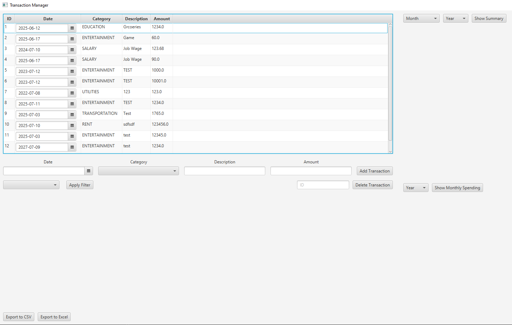

# Personal Finance Manager

## General Info

This project is a desktop application that allows users to track and manage financial transactions. It uses a JavaFX graphical interface and a local SQLite database to record income and expenses, view spending summaries, and visualize financial activity.

## Features

- Add, view, edit, and delete transactions with a date, category, description, and amount.
- Store transaction data locally using SQLite.
- Filter transactions by category, date range, or amounts above or below a specified value.
- View monthly income, expenses, and net balance for a selected month and year.
- Visualize transactions using a spending-by-category pie chart and a monthly income-versus-expenses bar chart.
- Export transaction data to CSV or Excel (`.xlsx`) files.

## Usage Instructions

You'll need **Java Development Kit (JDK) 21** and **Apache Maven** installed.

Open a terminal in the project directory containing `pom.xml`, then run:

```bash
mvn javafx:run
```

Maven will download the required dependencies and launch the **Transaction Manager** window.



From there:

- Fill in the date, category, description, and amount fields, then click Add Transaction.
- Edit existing transaction details directly in the table, or delete a transaction by entering its ID.
- Choose a filter type and click Apply Filter to narrow the displayed transactions.
- Select a month and year, then click Show Summary to view totals and the category pie chart.
- Select a year and click Show Monthly Spending to view the income and expenses bar chart.
- Use Export to CSV or Export to Excel to save transaction records.

The application automatically creates a local SQLite database on first launch if one does not already exist. Transaction data is preserved between sessions.

## Limitations

- The application uses a local SQLite database; it does not provide cloud synchronization or multiple user accounts.
- Financial summaries and charts update when their respective buttons are clicked rather than automatically after each change.
- CSV and Excel exports currently use the transaction list loaded when the application starts, so restarting the application may be necessary to include more recent changes.
